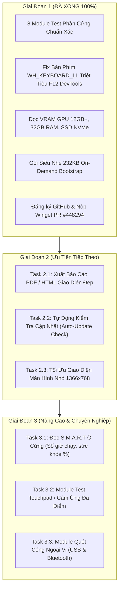

# ⚡ IMPLEMENTATION PLAN & CẨM NANG "VIBE CODING" DỰ ÁN LONG AT TEST

> **Tài liệu bàn giao & Lịch trình phát triển dành cho máy tính mới**  
> **Thư mục dự án:** `H:\toollong\test\test pc` (hoặc thư mục clone bất kỳ)  
> **GitHub Repository:** [https://github.com/vulongvy/LongATTest](https://github.com/vulongvy/LongATTest)  
> **Tác giả:** Đặng Vũ Long (Long AT)  
> **Mục đích:** Đem sang máy tính khác mở lên là hiểu ngay kiến trúc, khởi động môi trường chỉ trong 1 phút và tiếp tục "vibe code" mở rộng tính năng mới siêu nhanh.

---

## 🗺️ PHẦN 1: BẢN ĐỒ KIẾN TRÚC DỰ ÁN (PROJECT ARCHITECTURE MAP)

Dự án được xây dựng theo mô hình **Dual-Engine (Động Cơ Kép)** kết hợp giữa Web UI hiện đại và 2 tầng Backend tương thích 100% mọi loại máy tính:

```
LongATTest/
│
├── 📁 web/                          <-- [FRONTEND GIAO DIỆN CHÍNH]
│   ├── index.html                   - Khung HTML chứa 8 module test & thanh điều hướng sidebar
│   ├── styles.css                   - Giao diện Cyber Dark, hiệu ứng đèn led phím, card, logo tròn
│   ├── app.js                       - Logic Web Audio (loa, mic), WebRTC (cam), Canvas oscilloscope, phím
│   └── logo.png                     - Logo thương hiệu hình tròn (512x512 trong suốt khử răng cưa)
│
├── 📁 scripts/                      <-- [ENGINE ĐO PHẦN CỨNG BẰNG POWERSHELL]
│   ├── get_specs.ps1                - Đọc CPU, RAM (hãng/bus), GPU VRAM 12GB+, SSD NVMe/HDD, Mainboard
│   ├── get_battery.ps1              - Đọc pin, dung lượng thiết kế, dung lượng thực, độ chai, chu kỳ sạc
│   ├── get_thermal.ps1              - Đọc thông số nhiệt độ / ACPI
│   └── stress_cpu.ps1               - Thuật toán tạo tải kiểm tra quạt / tải CPU
│
├── 📁 LongAT_App/                   <-- [BACKEND CHÍNH: C# WPF .NET 8 NATIVE]
│   ├── LongATTestApp.csproj         - File cấu hình dự án .NET 8 (nhúng WebView2 & LibreHardwareMonitor)
│   ├── MainWindow.xaml / .cs        - Cửa sổ ứng dụng, khởi tạo WebView2, nạp icon an toàn không lock file
│   ├── KeyboardHook.cs              - Low-Level Keyboard Hook (WH_KEYBOARD_LL) bắt trọn F1-F12 không vướng DevTools
│   ├── LocalServer.cs               - Máy chủ HTTP REST API nội bộ viết bằng C# (Port 8765 / 8766)
│   ├── HardwareEngine.cs            - Cầu nối gọi scripts PowerShell hoặc đọc WMI trực tiếp
│   ├── app.manifest                 - Manifest cấp quyền asInvoker
│   └── app.ico                      - Icon ứng dụng đa kích thước (16x16 -> 256x256)
│
├── 🐍 server.py                     <-- [BACKEND PHỤ: PYTHON UNIVERSAL SERVER]
│   └── Máy chủ HTTP độc lập chỉ dùng thư viện chuẩn Python (os, http.server, subprocess).
│       Tự động bật Edge/Chrome ở chế độ App Window độc lập (--app=http://127.0.0.1:8765).
│
├── 🚀 BỘ KHỞI ĐỘNG NHANH:
│   ├── Start_Tool.bat / .ps1        - Trình khởi chạy 1-Click tự kiểm tra & tự tải thư viện (.NET / WebView2)
│   ├── Run_Python.bat               - Trình chạy 1-Click bằng Python (dành cho máy đã có Python)
│   └── LongATTest.exe               - File chạy native C# biên dịch sẵn
│
├── 📦 ĐÓNG GÓI & PHÁT HÀNH:
│   ├── installer.iss                - Script biên dịch Inno Setup ra file LongATTest-Setup-1.0.0.exe
│   ├── manifests/                   - Bộ manifest Microsoft Winget v1.6.0 (PR #448294)
│   └── dist/                        - Thư mục chứa các bản build (.exe setup, .zip siêu nhẹ 232KB)
│
└── 📄 TÀI LIỆU:
    ├── README.md                    - Tài liệu GitHub chính thức
    ├── README_QUICKSTART.txt        - Hướng dẫn nhanh cho người nhận file
    ├── VIBE_CODING_GUIDE.md         - Hướng dẫn tóm tắt
    └── IMPLEMENTATION_PLAN.md       - File kế hoạch & roadmap chi tiết này!
```

---

## ⚡ PHẦN 2: THIẾT LẬP DỰ ÁN TRÊN MÁY TÍNH MỚI TRONG 1 PHÚT

Khi sang máy tính khác, bạn chỉ cần thực hiện 3 bước đơn giản:

### Cách A: Nếu máy mới có Git & VS Code
```bash
# 1. Kéo toàn bộ mã nguồn về
git clone https://github.com/vulongvy/LongATTest.git
cd LongATTest

# 2. Chạy thử ngay lập tức (chọn 1 trong 2 cách):
# Cách 1: Chế độ tự động tải thư viện:
.\Start_Tool.bat

# Cách 2: Chế độ Python siêu nhẹ (nếu máy đã có Python):
.\Run_Python.bat
```

### Cách B: Nếu máy mới không có Git (Copy thư mục USB / Zalo)
- Chỉ cần giải nén thư mục dự án vào bất kỳ ổ đĩa nào (`C:\`, `D:\`, `H:\`...).
- Nhấp đúp vào **`Start_Tool.bat`**: Script sẽ tự động chạy lệnh `Unblock-File` để gỡ bỏ khóa bảo mật Windows, kiểm tra các file cần thiết và bật tool lên ngay.

---

## 📅 PHẦN 3: LỊCH TRÌNH CHỈNH SỬA & TRIỂN KHAI (IMPLEMENTATION ROADMAP)

Dưới đây là lịch trình các giai đoạn phát triển để bạn tiếp tục "vibe code":



---

## 🛠️ PHẦN 4: HƯỚNG DẪN "VIBE CODING" CHI TIẾT TỪNG MODULE

### 1. Muốn thêm một Tab kiểm tra mới vào giao diện Web:
Chỉ cần thực hiện 3 bước:
- **Bước 1 (`web/index.html`):**
  - Thêm một nút menu vào `<nav class="sidebar">`:
    ```html
    <div class="nav-item" data-tab="tab-touchpad">
      <span class="icon">👆</span> Touchpad / Cảm Ứng
    </div>
    ```
  - Thêm nội dung panel vào `<main class="main-content">`:
    ```html
    <section class="tab-pane" id="tab-touchpad">
      <!-- Nội dung test ở đây -->
    </section>
    ```
- **Bước 2 (`web/styles.css`):** Thêm định dạng màu sắc hoặc hiệu ứng nếu cần.
- **Bước 3 (`web/app.js`):** Thêm sự kiện khởi tạo vào hàm `onTabSwitched(tabId)`:
  ```javascript
  if (tabId === 'tab-touchpad') initTouchpadTest();
  ```

### 2. Muốn sửa logic đọc thông số phần cứng:
- **Tất cả script phần cứng đều nằm ở `scripts/`**:
  - `scripts/get_specs.ps1`: Chỉnh sửa logic đọc CPU, RAM, GPU, ổ đĩa. Dữ liệu trả về dạng JSON chuẩn.
  - Sau khi sửa, bạn có thể chạy thử trực tiếp trong PowerShell để xem JSON:
    ```powershell
    powershell -ExecutionPolicy Bypass -File scripts\get_specs.ps1
    ```
- Cả **C# (`HardwareEngine.cs`)** lẫn **Python (`server.py`)** đều tự động lấy dữ liệu từ các file script này, do đó bạn **chỉ cần sửa 1 lần trong file PowerShell là cả 2 chế độ đều nhận thông số mới**!

### 3. Vòng lặp test siêu tốc khi sửa giao diện (Hot Reload):
- Nhấp chạy **`Run_Python.bat`**.
- Mở file trong `web/` lên sửa (bằng VS Code / Cursor / Sublime Text...).
- Nhấn `Ctrl + S` lưu lại, sau đó ra trình duyệt nhấn `F5` hoặc `Ctrl + F5` là thấy ngay kết quả, **không mất thời gian build lại project**!

---

## 💻 PHẦN 5: BỘ LỆNH CHEAT SHEET 1-CLICK DÀNH CHO BẠN

| Mục đích | Lệnh thực hiện (Mở PowerShell trong thư mục dự án) |
| :--- | :--- |
| **Khởi chạy Tool kiểm tra tự động** | `.\Start_Tool.bat` |
| **Khởi chạy Tool chế độ Python nhanh** | `.\Run_Python.bat` |
| **Biên dịch Standalone C# EXE** | `dotnet publish LongAT_App/LongATTestApp.csproj -c Release -o publish /p:PublishSingleFile=true /p:SelfContained=false`<br>`Copy-Item "publish\LongATTest.exe" -Destination "LongATTest.exe" -Force` |
| **Biên dịch File Cài Đặt Setup.exe** | `& "C:\Program Files (x86)\Inno Setup 6\ISCC.exe" installer.iss` |
| **Tạo file ZIP siêu nhẹ (~232 KB)** | `$pack = "dist\QuickStart"; New-Item -ItemType Directory -Path $pack -Force; Copy-Item "Start_Tool.bat","Start_Tool.ps1","Run_Python.bat","server.py","README_QUICKSTART.txt","app.ico" -Destination $pack; Copy-Item "web","scripts" -Destination $pack -Recurse; Compress-Archive -Path "$pack\*" -DestinationPath "dist\LongATTest_QuickStart_v1.0.0.zip" -Force; Remove-Item $pack -Recurse -Force` |
| **Đẩy code lên GitHub** | `git add .`<br>`git commit -m "update: noi dung sua"`<br>`git push origin main` |

---

## 📌 LƯU Ý QUAN TRỌNG KHI VIBE CODING SANG MÁY KHÁC:
1. **Tuyệt đối không nhúng tĩnh `Icon="app.ico"` trong file XAML** (`MainWindow.xaml`), vì WPF sẽ ném lỗi `Cannot locate resource 'app.ico'`. Icon đã được viết code nạp an toàn bằng C# trong `MainWindow.xaml.cs`.
2. Luôn giữ `scripts/*.ps1` trả về kết quả bằng định dạng chuỗi JSON UTF-8 sạch (`ConvertTo-Json -Compress`), để cả C# lẫn Python đều parse được trơn tru.
3. Khi chia sẻ cho khách hàng hoặc người dùng cuối, hãy gửi file:  
   👉 `dist\LongATTest_QuickStart_v1.0.0.zip` (Chỉ 232 KB)  
   Khách chỉ cần giải nén và bấm `Start_Tool.bat` là máy tự tải và làm hết mọi việc còn lại.
